# Monday Morning Brief

**A short weekly message that tells an online store owner what changed, why it changed, and what to do about it.**


> [!IMPORTANT]
> **The goal:** catch what a dashboard can miss. In the sample store, the best-selling grinder sells out, and a messy supplier spreadsheet shows the next shipment is three weeks away. That leaves about **$43K in sales at risk**, and the brief should say so in plain English.



*This is the output the project is building toward, using fictional sample data.*

## The problem

Store owners have plenty of reports, but the facts that matter are often split across their store, ad accounts, and spreadsheets. Someone still has to connect them and decide what to do next.

This tool does that once a week and delivers only the few things that need attention.

## How it works



**One rule shapes the design: the AI never does the math.** Snowflake and dbt calculate every figure, Bedrock explains those figures, and a final check blocks the brief if any number doesn't match.

## The sample store

The project uses a fictional coffee gear brand with 20 products, 12 weeks of orders, and about $3M in yearly sales. Three problems are planted in the final week so the brief has something real to find.

| Planted problem | What the data shows |
| --- | --- |
| Best-selling grinder sold out | Revenue fell 20.9% to $43,586, and the next 300 units arrive Nov 22 |
| Ad spend rose without results | Meta spend rose 27.2% to $7,162, while new customers stayed flat at 229 |
| Travel mug refunds spiked | Mug refunds jumped from about 2 a week to 52, and 51 cite a leaking lid |

The supplier tracker is deliberately messy. It has no product IDs, and its names and date formats are inconsistent, because real spreadsheets rarely line up neatly with store data.

## Tech stack

| Tool | Role |
| --- | --- |
| Python | Generates the sample data and connects the pipeline |
| Snowflake | Stores the data and runs the queries |
| dbt | Builds and tests the weekly comparison |
| Amazon Bedrock | Writes the brief from verified facts |
| Slack | Delivers the finished brief |

## Project status

- [x] Set up the repository and Python project
- [x] Build the sample data generator
- [x] Add the messy supplier tracker
- [x] Load the data into Snowflake
- [ ] Build the dbt models
- [ ] Generate the brief with Amazon Bedrock
- [ ] Add the number check
- [ ] Deliver the brief to Slack
- [ ] Record the demo

## Run it

The sample data step works today. You'll need [uv](https://docs.astral.sh/uv/) installed.

```bash
uv sync
uv run python data_generator/generate_data.py
uv run python snowflake/load_raw.py
```

This creates seven CSV files in `data/raw/` and prints a weekly summary.

## Project structure

```text
monday-morning-brief/
├── data_generator/
│   └── generate_data.py    # Creates the fictional store data
├── docs/                   # README graphics
├── pyproject.toml          # Project dependencies
└── README.md
```

---

All data in this project is fictional. No real store or customer data is used.
